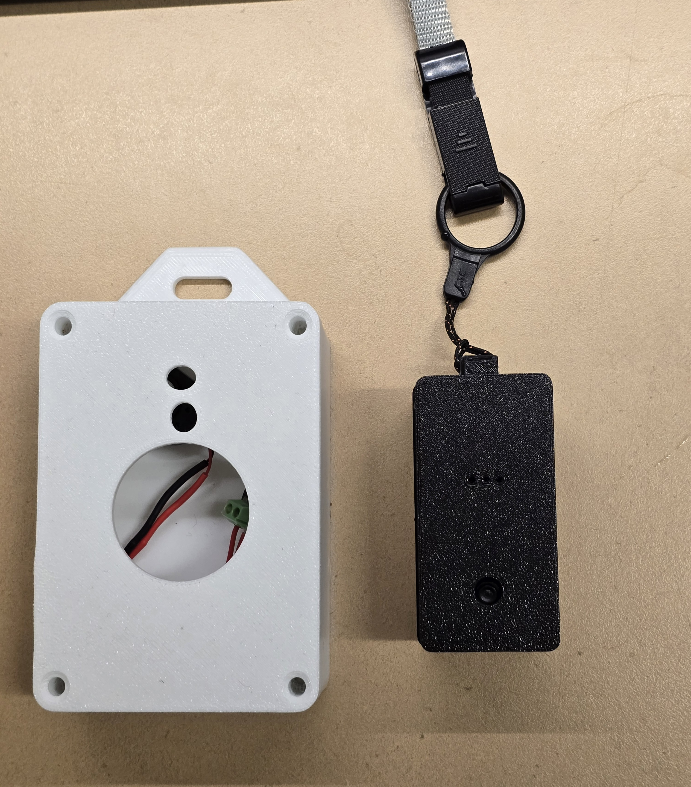
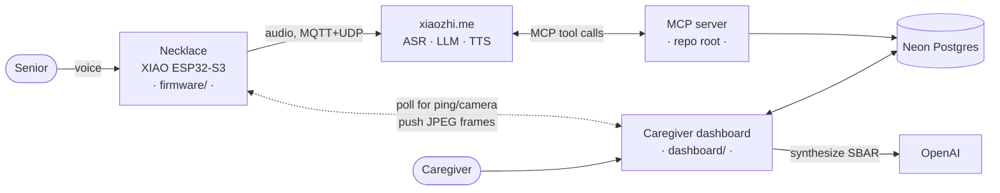
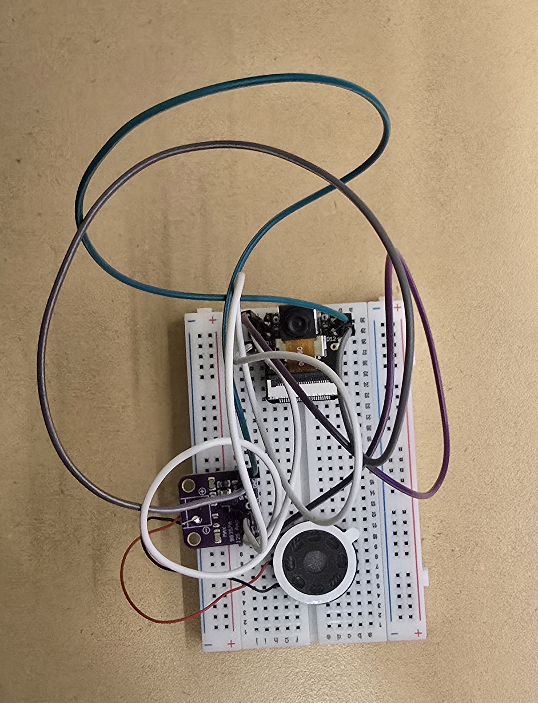
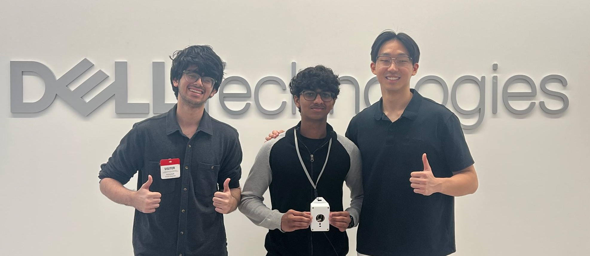

# Yoda

A care necklace seniors can talk to. Yoda supports daily check-ins and care requests, with a dashboard for their caregiver.

**[Demo video](https://www.youtube.com/watch?v=fLG9y0mhrLA)** · Top 5 Finalist, Dell InnovateDash 2026 (Care Corner)

<p align="center">
  
  <br />
  <em>The early enclosure beside the smaller pendant prototype.</em>
</p>

The wake word is "Jarvis", using Espressif's pre-trained wake-word model. The project name is still Yoda.

## Why

Care Corner's challenge was about seniors struggling to reach services that already existed. Information was scattered across providers, and finding the right help meant navigating websites, enquiries and forms.

The interRAI assessment supplied with the challenge was five dense pages of health, daily-living and caregiver details. Yoda uses the senior's saved record to ask relevant questions in a spoken check-in, then brings their answers into the caregiver's dashboard. A senior can describe what they need without navigating another app, and the caregiver has the context to follow up.

## What it does

**Daily check-in.** The voice agent asks recovery questions based on the senior's record, such as whether they took their medication or have trouble breathing. It saves the answers as a health incident. The dashboard generates an SBAR handover: situation, background, assessment and recommendation.

**Welfare check.** A caregiver can ping the necklace from the dashboard and ask the senior to respond. The dashboard also provides a camera check. The necklace plays an announcement before sending camera frames through the relay.

Activity requests wait for the caregiver's approval. The voice tools can save profile updates and health-check responses directly.

## Architecture



The cloud LLM is the only thing that calls the tools. The dashboard and the MCP server never talk to each other directly, they meet at the database.

## Engineering decisions

**The MCP server connects out through a WebSocket.** The cloud needs to call tools on a server that may be behind NAT. [`mcp_pipe.py`](mcp_pipe.py) opens an outbound connection to the cloud's MCP endpoint and pipes messages to a local stdio FastMCP process, without opening an inbound port.

**The emergency watchdog is a SQL expression, not a worker.** If she starts a health check and then goes quiet, that silence has to become an alert. Instead of a cron job or a background queue, the escalation is derived at query time:

```sql
CASE WHEN status = 'in_progress' AND now() - started_at > make_interval(secs => 25)
     THEN 'emergency' ...
```

The dashboard polls every 3 seconds and reads this derived status. A health check left `in_progress` for more than 25 seconds appears as an emergency on the next refresh, without a separate scheduled worker.

**The camera relay works across networks.** The first version required the caregiver and necklace to share Wi-Fi. The necklace now polls the deployed dashboard for commands and uploads JPEG frames over HTTPS. Both connections are outbound, so it also works over a mobile hotspot without port forwarding.

**Polling competed with wake-word detection.** Opening a fresh TLS connection every 2 seconds used enough CPU to interrupt the on-device wake-word detector. Increasing the idle interval to 15 seconds restored it. Camera streaming still competes for that CPU while the caregiver is viewing it.

**The camera announces itself.** The firmware plays the announcement before uploading relay frames, with a 2.5-second delay before capture. The dashboard handles the caregiver's ping and camera controls.

## Hardware

The pendant uses a Seeed XIAO ESP32-S3 Sense with its camera and microphone, a MAX98357A I2S amplifier, a speaker and a 3.7 V LiPo battery.

<p align="center">
  
  <br />
  <em>The camera board, amplifier and speaker before assembly into the pendant.</em>
</p>

Use the [pin table and speaker troubleshooting guide](firmware/README.md#hardware) when wiring it. The XIAO's D0, D1 and D2 pads are GPIO 1, 2 and 3: the amplifier's LRC, BCLK and DIN connections respectively. The photo shows the prototype assembly, not a pin-by-pin wiring diagram.

[Firmware build and flash instructions](firmware/README.md#build-from-scratch) · [Enclosure and printable files](cad/README.md)

## Service integrations

The voice loop, MCP tools, database, health-check flow, SBAR report and camera relay are implemented. Community-care bookings are mocked in [`services.py`](services.py): this project does not connect to the providers' booking systems.

The firmware builds on [`78/xiaozhi-esp32`](https://github.com/78/xiaozhi-esp32) (MIT). The additions here are the Yoda board definition, welfare HTTP API, cloud relay and camera path.

## Where to start in the code

- [MCP tools](yoda_iccp.py) and [WebSocket connection](mcp_pipe.py). The tool implementations use [health incidents](health_db.py), [senior profiles](kb_store.py), [activity matching](events.py) and [provider adapters](services.py).
- [Caregiver dashboard](dashboard/). `app/` contains the care view, welfare controls and SBAR page. `lib/` contains database queries and report generation.
- [Pendant firmware](firmware/). Board configuration, welfare HTTP API and camera relay.
- [Enclosure](cad/). Parametric case design and printable files.

The tool reference below lists all eight tools. [SYSTEM_PROMPT.md](SYSTEM_PROMPT.md) configures how the cloud agent uses them. Test commands are in [Run it](#run-it).

## The tools

| Tool | What it does |
|------|--------------|
| `get_senior_profile` | Load the senior's saved profile before asking questions. |
| `begin_health_check` | Open an incident the moment she reports feeling unwell. Starts the silence timer. |
| `complete_health_check` | Save the triage responses and classify the incident as `mild` or `serious`. |
| `match_events` | Top 1-2 activities for her goals and area, excluding ones already requested |
| `request_activity` | Create a **pending request** for the caregiver. Never books directly. |
| `update_knowledge_base` | Save preferences learned in conversation |
| `get_onboarding_questions` | Short sign-up questions, only what isn't already known |
| `book_meal_delivery` | Mock meal booking |

## Run it

**MCP server** (repo root)

```bash
python -m venv .venv && .venv\Scripts\activate
pip install -r requirements.txt
# .env:  MCP_ENDPOINT=wss://api.xiaozhi.me/mcp/?token=...
#        DATABASE_URL=postgresql://...
python mcp_pipe.py yoda_iccp.py
```

Then paste `SYSTEM_PROMPT.md` into the xiaozhi.me console as the agent's role and hit Refresh on the MCP endpoint. Run only one MCP server at a time.

**Dashboard**

```bash
cd dashboard && npm install
# .env.local:  DATABASE_URL=...  OPENAI_API_KEY=...
npm run dev
```

**Tests**

```bash
pytest          # 14 tests: matching, KB merge, services, triage + escalation
```

## Security

`MCP_ENDPOINT`, `DATABASE_URL` and `OPENAI_API_KEY` live in `.env` / `.env.local`, both gitignored and never committed. The device token in `firmware/yoda-pendant/config.h` is a placeholder in this repo. Rotate the MCP token from the console if it ever leaks.

## At Dell InnovateDash

<p align="center">
  
  <br />
  <em>The team with the early pendant at Dell.</em>
</p>
